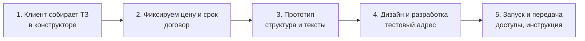
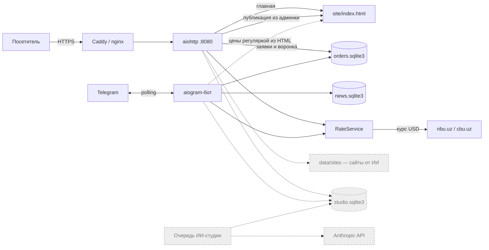
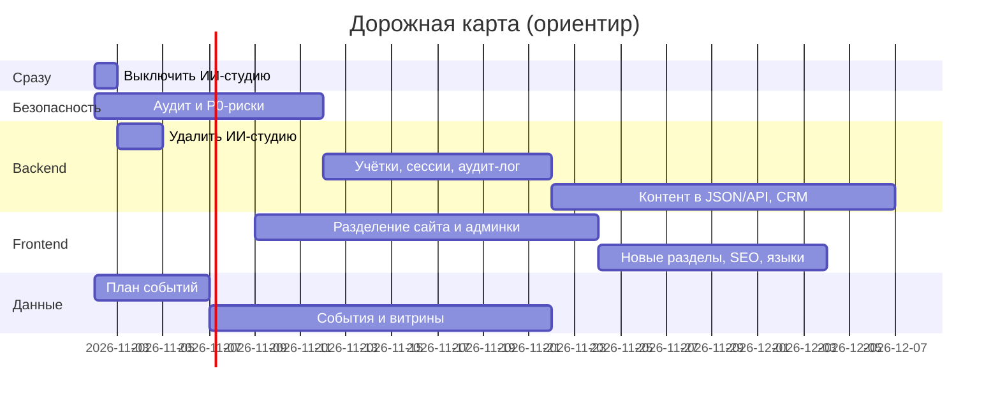

# Codex Lab — обзор проекта

> [!info] Что это
> **Codex Lab** — студия сайтов и Telegram-ботов из Ташкента. **Сайты и ботов делают программисты студии.**
> Программа в репозитории обслуживает продажи: сайт студии с конструктором ТЗ и вилкой цены, Telegram-бот (тарифы, ТЗ, новости) и доставку заявок админам.

> [!warning] ИИ-студия в коде — не то, как работает студия
> В коде есть модуль «студия из 20 ИИ-агентов»: бот бесплатно собирает любому человеку сайт без участия программистов.
> Студия так не работает, поэтому модуль — **к удалению** (см. [[01 Аудит сайта]], [[ТЗ Backend]] BE-13).

## Заметки

| Заметка | Для кого |
| --- | --- |
| [[01 Аудит сайта]] | владелец: чего не хватает, что лишнее, что сделано хорошо |
| [[ТЗ Backend]] | backend-разработчик |
| [[ТЗ Data Engineer]] | дата-инженер |
| [[ТЗ Frontend]] | фронтенд-разработчик |
| [[ТЗ Кибербезопасность]] | специалист по кибербезопасности |

## Как работает студия

Процесс описан на сайте, его ведут программисты:

Программа сейчас покрывает только **шаг 1** (ТЗ и заявка). Шаги 2–5 ведутся в Telegram, система о них ничего не знает — это закрывает [[ТЗ Backend]] BE-04.

## Из чего состоит программа

1. **Сайт студии** — `site/index.html`, один файл на 382 КБ (CSS 74 КБ, JS 258 КБ, данные 8 КБ). Три языка (RU/UZ/EN), цены в сумах или долларах по курсу NBU, конструктор ТЗ на 6 шагов, демо-концепты, встроенная админка. Админка пересобирает весь HTML и отправляет его на сервер (`POST /api/publish`).
2. **Telegram-бот** (aiogram 3.31): тарифы, конструктор ТЗ (та же формула цены, что на сайте), подписка на новости, админ-команды `/last /stats /forget /post /subscribers`.
3. **Приём заявок**: заявка сохраняется в SQLite, потом уходит админам в Telegram, повторы раз в минуту, без дублей (`client_id`).
4. **Новости**: рассылка подписчикам бота без дублей после перезапуска.
5. ⚠️ **ИИ-студия — к удалению.** 20 агентов на Claude собирают сайт по анкете из бота (`/site`), сайты лежат на `/sites/<slug>/`, ход работы — на странице «Совет агентов». Это ~3,6 тыс. строк в `app/studio/`, заказ сайта в `app/user_bot.py`, 500 строк тестов и отдельная база.

## Стек

| Слой | Что используется |
| --- | --- |
| Язык | Python 3.11+ |
| HTTP | aiohttp 3.14.3 |
| Бот | aiogram 3.31.0 (long polling, FSM в памяти) |
| Данные | SQLite: `orders`, `news` (+ `studio` — к удалению); файлы `data/rate.json`, `site/backups/` |
| Фронт | один HTML-файл, ванильный JS без сборки, Google Fonts |
| Деплой | systemd + Caddy (или nginx + certbot), один VPS |
| Тесты | unittest, **63 теста, все проходят** (проверено 2026-10-29). CI нет |
| ⚠️ ИИ | anthropic 1.11.0 — нужен только ИИ-студии, уходит вместе с ней |

## Архитектура сейчас

Серым пунктиром — то, что удаляется вместе с ИИ-студией.

## Карта кода

| Файл | Что делает | Строк |
| --- | --- | --- |
| `app/main.py` | запуск всего в одном процессе | 134 |
| `app/config.py` | настройки из `.env` | 119 |
| `app/web.py` | сайт, заявки, воронка, публикация, лимиты, заголовки безопасности | 328 |
| `app/storage.py` | заявки и счётчики воронки (SQLite) | 120 |
| `app/bot.py` | пересылка заявок админам, админ-команды | 198 |
| `app/brief_bot.py` | тарифы и конструктор ТЗ в боте на 3 языках | 957 |
| `app/user_bot.py` | новости; ⚠️ заказ ИИ-сайта, правки, оценки, `/studio`, `/lessons` | 458 |
| `app/news.py` | подписчики и рассылка | 220 |
| `app/rates.py` | курс доллара NBU/CBU с кешем | 158 |
| `site/index.html` | сайт студии + админка | 4761 |
| ⚠️ `app/studio/` | ИИ-студия: конвейер, агенты, рендерер, совет, API | ~3 600 |

## Данные

| База / файл | Таблицы | Персональные данные |
| --- | --- | --- |
| `data/orders.sqlite3` | `orders`, `events` | имя, телефон, Telegram, текст ТЗ |
| `data/news.sqlite3` | `subscribers`, `news`, `news_deliveries` | chat_id, имя из Telegram |
| `site/backups/` | 20 прошлых версий сайта | — |
| ⚠️ `data/studio.sqlite3` | проекты, сообщения агентов, уроки, `leads` | брифы с контактами, имена и телефоны клиентов с сайтов от ИИ |
| ⚠️ `data/sites/` | HTML сайтов от ИИ, все версии | контакты бизнеса |

## Внешние зависимости

- Telegram Bot API: бот и доставка заявок.
- `nbu.uz`, запасной `cbu.uz`: курс доллара.
- Google Fonts: шрифты сайта.
- ⚠️ Anthropic API — только для ИИ-студии.

## Порядок работ

> [!tip] Зависимости между ролями
> - **Вывод ИИ-студии**: Backend удаляет код и маршруты, безопасность проверяет удаление данных и отзыв ключей, Frontend убирает ссылки и страницы.
> - **Data Engineer** пишет план событий → **Frontend** и **Backend** отправляют события по нему.
> - **Кибербезопасность** формулирует требования к входу и сессиям → **Backend** их реализует, **Frontend** делает экран входа.
> - **Backend** выносит контент сайта из HTML в JSON и API → **Frontend** переходит на шаблоны и отдельную админку.
