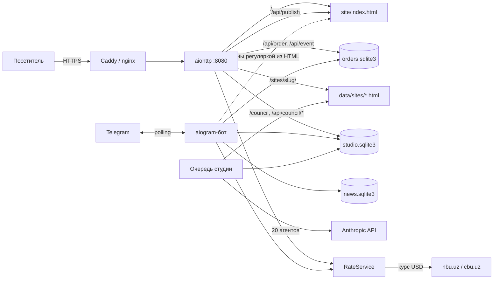
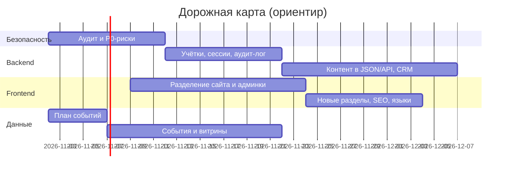

# Codex Lab — обзор проекта

> [!info] Что это
> **Codex Lab** — студия сайтов и Telegram-ботов из Ташкента. Весь продукт — одна программа на Python в одном процессе:
> сайт студии с конструктором ТЗ, Telegram-бот, рассылка новостей и «студия» из 20 ИИ-агентов, которая бесплатно собирает
> клиентам white-label сайты.

## Заметки

| Заметка | Для кого |
| --- | --- |
| [[01 Аудит сайта]] | владелец: чего не хватает, что лишнее, что сделано хорошо |
| [[ТЗ Backend]] | backend-разработчик |
| [[ТЗ Data Engineer]] | дата-инженер |
| [[ТЗ Frontend]] | фронтенд-разработчик |
| [[ТЗ Кибербезопасность]] | специалист по кибербезопасности |

## Из чего состоит продукт

1. **Сайт студии** — `site/index.html`, один файл на 382 КБ (CSS 74 КБ, JS 258 КБ, данные 8 КБ). Три языка (RU/UZ/EN), цены в сумах или долларах по курсу NBU, конструктор ТЗ на 6 шагов, демо-концепты, встроенная админка. Админка пересобирает весь HTML и отправляет его на сервер (`POST /api/publish`).
2. **Telegram-бот** (aiogram 3.31): тарифы, конструктор ТЗ (та же формула цены, что на сайте), подписка на новости, заказ ИИ-сайта (`/site`), админ-команды `/last /stats /forget /post /studio /lessons`.
3. **Приём заявок**: заявка сохраняется в SQLite, потом уходит админам в Telegram, повторы раз в минуту, без дублей (`client_id`).
4. **Новости**: рассылка подписчикам бота без дублей после перезапуска.
5. **Студия из 20 ИИ-агентов** (Claude, есть офлайн-режим): брифинг → исследование → 3 концепции → спор → решение → производство → ревью → правки → публикация → ретро с уроками. Агенты отдают только данные, HTML собирает рендерер. Сайты клиентов лежат на `/sites/<slug>/`, ход работы показан на странице «Совет агентов» (`/council`, `/studio/p/<token>`).

## Стек

| Слой | Что используется |
| --- | --- |
| Язык | Python 3.11+ |
| HTTP | aiohttp 3.14.3 |
| Бот | aiogram 3.31.0 (long polling, FSM в памяти) |
| ИИ | anthropic 1.11.0, модель `claude-opus-5-5`, structured outputs |
| Данные | SQLite ×3 (`orders`, `news`, `studio`) + файлы (`data/sites/`, `data/rate.json`, `site/backups/`) |
| Фронт | один HTML-файл, ванильный JS без сборки, Google Fonts |
| Деплой | systemd + Caddy (или nginx + certbot), один VPS |
| Тесты | unittest, **63 теста, все проходят** (проверено 2026-10-29). CI нет |

## Архитектура сейчас

## Карта кода

| Файл | Что делает | Строк |
| --- | --- | --- |
| `app/main.py` | запуск всего в одном процессе | 134 |
| `app/config.py` | настройки из `.env` | 119 |
| `app/web.py` | сайт, заявки, воронка, публикация, лимиты, заголовки безопасности | 328 |
| `app/storage.py` | заявки и счётчики воронки (SQLite) | 120 |
| `app/bot.py` | пересылка заявок админам, админ-команды | 198 |
| `app/brief_bot.py` | тарифы и конструктор ТЗ в боте на 3 языках | 957 |
| `app/user_bot.py` | новости, заказ ИИ-сайта, правки, оценки | 458 |
| `app/news.py` | подписчики и рассылка | 220 |
| `app/rates.py` | курс доллара NBU/CBU с кешем | 158 |
| `app/studio/pipeline.py` | конвейер из 20 агентов | 616 |
| `app/studio/store.py` | проекты, сообщения, задачи, уроки, лиды | 418 |
| `app/studio/renderer.py` | спецификация → HTML сайта клиента | 363 |
| `app/studio/web.py` | сайты клиентов, лиды с них, совет, служебное API | 267 |
| `app/studio/llm.py` | Claude / офлайн-заглушка, подсчёт стоимости | 154 |
| `site/index.html` | сайт студии + админка | 4761 |

## Данные

| База / файл | Таблицы | Персональные данные |
| --- | --- | --- |
| `data/orders.sqlite3` | `orders`, `events` | имя, телефон, Telegram, текст ТЗ |
| `data/news.sqlite3` | `subscribers`, `news`, `news_deliveries` | chat_id, имя из Telegram |
| `data/studio.sqlite3` | `projects`, `messages`, `tasks`, `lessons`, `lesson_uses`, `agent_stats`, `leads` | бриф с контактами, имя и телефон клиентов с сайтов клиентов |
| `data/sites/` | HTML сайтов клиентов, все версии | контакты бизнеса |
| `site/backups/` | 20 прошлых версий сайта | — |

## Внешние зависимости

- Telegram Bot API: бот и доставка заявок.
- `nbu.uz`, запасной `cbu.uz`: курс доллара.
- Anthropic API: агенты студии (без ключа — офлайн-режим).
- Google Fonts: шрифты на сайте студии и на сайтах клиентов.

## Порядок работ

> [!tip] Зависимости между ролями
> - **Data Engineer** пишет план событий → **Frontend** и **Backend** отправляют события по нему.
> - **Кибербезопасность** формулирует требования к входу и сессиям → **Backend** их реализует, **Frontend** делает экран входа.
> - **Backend** выносит контент сайта из HTML в JSON и API → **Frontend** переходит на шаблоны и отдельную админку.
> - Отдельный домен для сайтов клиентов — общее решение Backend, Frontend и безопасности (см. [[ТЗ Кибербезопасность]], SEC-04).
