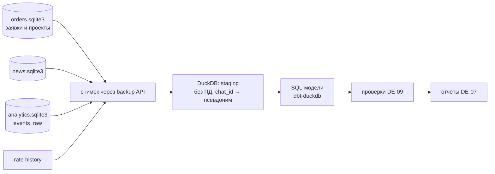

# ТЗ для дата-инженера

> [!info] Контекст
> Сайты клиентам делают **программисты студии**; программа обслуживает продажи: сайт с конструктором ТЗ, бот, заявки.
> Данные — базы SQLite на одном VPS (`orders`, `news`) и файл курса доллара. База ИИ-студии (`studio`) удаляется вместе с модулем ([[ТЗ Backend]] BE-13) — в хранилище её не берём. Обзор — в [[00 Обзор проекта]].
> Сейчас вся аналитика — 4 суточных счётчика (`visit`, `brief_start`, `brief_done`, `order`) и команда `/stats` в боте.
> События отправляют [[ТЗ Frontend]] (сайт) и [[ТЗ Backend]] (сервер и бот), по плану из этого ТЗ.

> [!warning] Масштаб
> Данных мало: десятки заявок в месяц, тысячи событий в день в лучшем случае. **Не нужны** Spark, Kafka, облачные хранилища и потоковая обработка.
> Достаточно ночной выгрузки в DuckDB, SQL-моделей и простых отчётов. Решение должно обслуживаться одним человеком за час в неделю.

## Чего хочет бизнес

1. Понимать, **какой канал приносит заявки и договоры**, а не просто посещения.
2. Видеть, **на каком шаге конструктора ТЗ люди уходят**.
3. Видеть **план и факт**: насколько вилка из конструктора совпадает с суммой договора и укладываются ли программисты в сроки этапов.
4. Получать **еженедельный отчёт** в Telegram без захода в отдельные системы.

## Ограничения приватности

Сайт сейчас обещает: «Счётчик воронки хранит только число событий за день: ни адресов, ни устройств, ни файлов cookie». Сохраняем дух обещания:

- без cookie и без постоянного идентификатора посетителя; допускается случайный id **вкладки** в `sessionStorage`, который живёт до закрытия вкладки;
- без IP и user-agent в событиях; класс устройства (`mobile`/`desktop`) присылает фронт;
- имена, телефоны, ники и тексты ТЗ в аналитическое хранилище **не попадают**;
- `chat_id` Telegram попадает только как псевдоним: `HMAC-SHA256(secret, chat_id)`, секрет в `.env`, в хранилище его нет;
- изменения согласовать с [[ТЗ Кибербезопасность]] SEC-09 и отразить в политике конфиденциальности.

## Приоритеты

| ID | Задача | Приоритет | Оценка |
| --- | --- | --- | --- |
| DE-01 | План событий | P0 | 2–3 дн. |
| DE-02 | Атрибуция сайта: UTM, реферер, сессия | P0 | 1 дн. + работа фронта |
| DE-03 | Атрибуция бота: deep-link метки | P0 | 1 дн. + работа бэкенда |
| DE-09 | Качество данных и приватность | P0 | 1–2 дн. |
| DE-04 | Хранилище и ночная выгрузка | P1 | 3–4 дн. |
| DE-05 | Витрины и метрики | P1 | 3–4 дн. |
| DE-06 | План/факт: цена и сроки проектов | P1 | 2–3 дн. |
| DE-07 | Отчёты: еженедельный в Telegram и дашборд | P1 | 2–3 дн. |
| DE-08 | История курса доллара | P2 | 0,5 дн. |
| DE-10 | Аналитика новостей | P2 | 1 дн. |

---

## P0

### DE-01 · План событий

**Результат:** отдельная заметка `План событий` в этом хранилище Obsidian — таблица событий, по которой работают фронт и бэк. Ниже — стартовый список, его нужно проверить, дополнить и утвердить с владельцем.

**Общие поля каждого события:** `name`, `ts` (UTC), `session` (id вкладки или псевдоним чата), `surface` (`site` | `bot` | `server`), `lang` (`ru`/`uz`/`en`), `app_version`.

**Сайт**

| Событие | Когда | Свойства |
| --- | --- | --- |
| `page_view` | открыли страницу | `path`, `utm_source`, `utm_medium`, `utm_campaign`, `ref_domain`, `device` |
| `lang_switched` | сменили язык | `from`, `to` |
| `currency_switched` | сменили валюту | `to` (`uzs`/`usd`), `rate_source` (`nbu`/`cbu`/`fallback`) |
| `cta_clicked` | нажали кнопку действия | `cta_id`, `section` |
| `example_opened` | открыли демо | `demo_id` |
| `want_similar_clicked` | «Хочу похожий» | `demo_id` или `project_id` |
| `brief_started` | первый шаг конструктора | `entry` (откуда пришли: hero, prices, example) |
| `brief_step_viewed` | показали шаг | `step` (0–6) |
| `brief_step_completed` | ушли с шага «Дальше» | `step`, `skipped_fields` (число) |
| `brief_type_selected` | выбрали тип | `type` |
| `brief_done` | ТЗ собрано | `type`, `features_n`, `langs_n`, `estimate_lo`, `estimate_hi`, `budget`, `deadline` |
| `order_submitted` | сервер сохранил заявку | `type`, `channel` (`site`) — **шлёт сервер**, не браузер |
| `order_fallback_used` | ушли в Telegram или почту вместо отправки | `via` |

**Бот**

| Событие | Свойства |
| --- | --- |
| `bot_start` | `source` (из deep-link), `is_new` |
| `prices_viewed` | `plan` |
| `bot_brief_started` / `bot_brief_step` / `bot_brief_done` | `step`, `type`, `estimate_lo`, `estimate_hi` |
| `order_submitted` | `channel` = `bot`, `type` |
| `news_subscribed` / `news_unsubscribed` | `reason` (`command`, `blocked`) |

**Заявки и проекты (CRM, [[ТЗ Backend]] BE-04) — шлёт сервер**

| Событие | Свойства |
| --- | --- |
| `order_status_changed` | `order_ref`, `from`, `to`, `amount_uzs`, `lost_reason` |
| `project_created` | `project_ref`, `order_ref`, `type`, `planned_weeks` |
| `project_stage_changed` | `project_ref`, `stage` (`contract`/`prototype`/`development`/`launch`/`support`), `planned_date`, `actual_date` |
| `payment_received` | `project_ref`, `stage`, `amount_uzs` (после [[ТЗ Backend]] BE-10) |

**Готово, когда:**
- [ ] Заметка `План событий` утверждена владельцем; у каждого события есть владелец (фронт или бэк) и пример JSON.
- [ ] Ни одно свойство не содержит персональных данных.

### DE-02 · Атрибуция сайта

1. Фронт читает `utm_*` и домен реферера **при первом просмотре в вкладке** и прикладывает их к `page_view` ([[ТЗ Frontend]] FE-09).
2. В заявку с сайта (`POST /api/order`) фронт добавляет `source` = `utm_source`/`ref_domain`/`direct`; бэк сохраняет в `orders.source` ([[ТЗ Backend]] BE-04, BE-09).
3. Правила каналов (справочник `dim_channel`): `google`/`yandex` без UTM → `organic`; `t.me`, `instagram.com` → `social`; `utm_medium=cpc` → `paid`; пусто → `direct`.
4. Список UTM-меток для владельца: какие ставить в Instagram, Telegram-каналах, рекламе.

### DE-03 · Атрибуция бота

1. Ссылки вида `t.me/<бот>?start=src_<канал>_<кампания>` для каждого канала (сайт, Instagram, реклама, визитки с QR).
2. Бэк сохраняет первую метку чата (`chat_sources`, [[ТЗ Backend]] BE-09) и прикладывает `source` к заявкам из бота.
3. Для связки «чат бота → заявка → договор» в заявках из бота нужен псевдоним чата (сейчас в `orders` нет `chat_id`) — задача бэкенду ([[ТЗ Backend]] BE-09).
4. Таблица ссылок с метками — в отдельной заметке Obsidian, чтобы владелец брал их оттуда.

### DE-09 · Качество данных и приватность

1. Проверки в SQL-моделях: уникальность ключей, `not null`, допустимые значения (`status`, `type`, `lang`), свежесть (последнее событие не старше 24 ч, последняя заявка — 7 дней, иначе предупреждение).
2. Проверка «нет ПД»: в хранилище нет колонок `name`, `phone`, `telegram`, `text`, `message`, `contacts`; тест падает, если появятся.
3. Сверка: число `order_submitted` за день = числу новых строк в `orders` за день.
4. Результат проверок — в утреннее сообщение админу, только если что-то не так.

---

## P1

### DE-04 · Хранилище и ночная выгрузка

**Схема:**

1. Каждую ночь в 03:30 по Ташкенту (systemd-таймер): снимок каждой базы через `sqlite3` backup API — без блокировки рабочего сервера.
2. Загрузка в `analytics.duckdb` инкрементально (по `id` и `updated_at`); повторный запуск не создаёт дублей.
3. Модели на SQL — `dbt-duckdb` в папке `analytics/` репозитория; README с командами запуска.
4. Нагрузка на прод: выгрузка ≤ 1 минуты, без заметного роста времени ответа сайта.
5. Хранилище лежит на том же сервере в `data/analytics/` и входит в бэкап ([[ТЗ Backend]] BE-06). Отдельный сервер — только если владелец решит ставить Metabase.

### DE-05 · Витрины и метрики

**Модели:**

| Модель | Зерно | Ключевые поля |
| --- | --- | --- |
| `dim_date` | день (Ташкент) | неделя, месяц, рабочий день |
| `dim_channel` | канал | `source`, `medium`, `channel_group` |
| `fct_sessions` | вкладка | первый канал, язык, устройство, дошёл ли до шага N, собрал ли ТЗ, отправил ли |
| `fct_brief_steps` | сессия × шаг | просмотрен, пройден, пропущено полей, время на шаге |
| `fct_orders` | заявка | канал, тип, вилка, бюджет, статус, сумма договора, время первого ответа |
| `fct_bot_funnel` | чат-псевдоним × день | start, тарифы, ТЗ, заявка |
| `fct_projects` | проект | тип, ответственный, вилка из ТЗ, сумма договора, плановый и фактический срок, оплачено |
| `fct_project_stages` | проект × этап | плановая и фактическая дата, просрочка в днях |
| `fct_news` | выпуск | отправлено, ошибок, отписок за 48 ч, клики |

**Метрики (определения фиксируем в заметке `Метрики`):**

- Воронка сайта: просмотр → начал ТЗ → собрал ТЗ → заявка. Цели уже заложены в `/stats`: **5%** посетителей до готового ТЗ, **50%** собравших ТЗ отправляют заявку.
- Отвал по шагам конструктора.
- Заявки и договоры по каналам; конверсия «заявка → договор»; средний чек; выручка по каналам.
- Время первого ответа на заявку (медиана, 90-й процентиль).
- Совпадение вилки и выбранного бюджета: насколько часто клиент хочет дешевле, чем стоит.
- Проекты в работе: сколько на каждом этапе, сколько просрочено, загрузка каждого программиста.
- Доля UZ и EN, доля цен в долларах.

### DE-06 · План/факт: цена и сроки проектов

Данные появляются после CRM ([[ТЗ Backend]] BE-04): заявка → договор → этапы с плановыми и фактическими датами.

1. **Цена.** Вилка из конструктора против суммы договора по типам проектов (лендинг, сайт компании, магазин, веб-сервис, бот) и по функциям. Где договор систематически выше или ниже вилки — рекомендация, какие цены в `catalog.json` поправить.
2. **Сроки.** Срок из ТЗ против фактического по проекту и по этапам (прототип, разработка, запуск). Какие этапы и типы проектов срываются чаще.
3. **Загрузка.** Проекты в работе на каждого программиста по неделям — чтобы видеть, когда брать новые заказы.
4. **Деньги** (после [[ТЗ Backend]] BE-10): сколько оплачено по этапам, дебиторка.
5. Результат — раз в месяц короткая заметка в Obsidian «Цены и сроки: что поправить» с цифрами.

### DE-07 · Отчёты

1. **Еженедельный отчёт в Telegram** (понедельник, 09:00 по Ташкенту, в чат владельца): посещения и заявки по каналам против прошлой недели, конверсия по шагам, договоры и выручка, проекты в работе и просроченные этапы, проблемы с данными. Текст ≤ 25 строк, без персональных данных.
2. **Дашборд** — на выбор владельца:
   - статические отчёты (Evidence или HTML из Python), собираются ночью и открываются в админке за входом;
   - или Metabase на отдельной небольшой машине, если нужна свободная работа с данными.
3. `/stats` в боте перевести на витрины (с отметкой даты последней выгрузки).

---

## P2

### DE-08 · История курса доллара

Сейчас хранится только последний курс (`data/rate.json`). Нужна таблица `rate_history (date, usd, source)`: заполняется при каждом новом курсе, плюс разовая загрузка истории с `cbu.uz`. Нужна, чтобы пересчитывать договоры и вилки в доллары по курсу на дату.

### DE-10 · Аналитика новостей

Клики через `/r/{news_id}` ([[ТЗ Backend]] BE-09), отписки и блокировки в течение 48 часов после рассылки, лучшее время отправки.

---

## Результаты работы

- [ ] Заметки Obsidian: `План событий`, `Метрики`, `UTM и deep-link метки`.
- [ ] Папка `analytics/` в репозитории: выгрузка, модели, проверки, README.
- [ ] Таймер ночной выгрузки и еженедельного отчёта (systemd).
- [ ] Дашборд или статические отчёты в админке.
- [ ] Инструкция: что делать, если выгрузка упала.

## Вне рамок

- Отслеживание людей между сессиями, fingerprinting, сторонние пиксели рекламных сетей без решения владельца и обновления политики.
- Облачные хранилища (BigQuery, Snowflake) и потоковая обработка.

## Вопросы к владельцу

- [ ] Нужен ли интерактивный BI (Metabase) или хватит отчётов в Telegram и статических страниц?
- [ ] Можно ли подключить Яндекс Метрику или Google Analytics на сайт студии? Это ломает обещание «без cookie» и требует баннера согласия.
- [ ] Какие каналы продвижения уже используются (для справочника UTM)?
