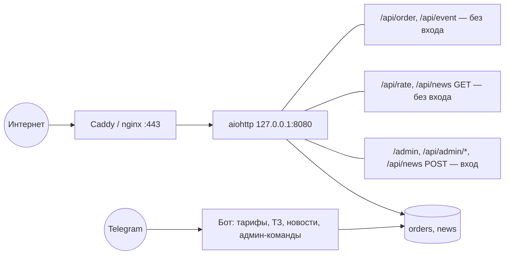

# ТЗ для специалиста по кибербезопасности

> [!info] Контекст
> Сайты клиентам делают **программисты студии**; сервер обслуживает продажи: сайт с конструктором ТЗ, Telegram-бот, заявки, новости.
> Один VPS, один процесс Python (aiohttp + aiogram), базы SQLite, Caddy или nginx перед ним. Внешние сервисы: Telegram Bot API, nbu.uz / cbu.uz, Google Fonts.
> Модуль «ИИ-студия» (Claude, сайты по анкете любого человека на домене студии) выводится из эксплуатации — SEC-04.
> Обзор — [[00 Обзор проекта]], найденные проблемы — [[01 Аудит сайта]].
> Реализуют исправления [[ТЗ Backend]] и [[ТЗ Frontend]]; задача этого ТЗ — **требования, проверка и приёмка**.

## Что защищаем

| Актив | Где | Чем ценен |
| --- | --- | --- |
| Заявки клиентов (имя, телефон, Telegram, ТЗ) | `data/orders.sqlite3`, чаты админов | персональные данные, коммерческая тайна |
| Проекты и договоры (после CRM) | `data/orders.sqlite3` | суммы, сроки, ссылки на тестовые адреса клиентов |
| Подписчики бота | `data/news.sqlite3` | канал рассылки на всех пользователей |
| Главный домен | `site/index.html` | репутация, доверие, точка приёма заявок |
| Токен бота | `.env` | чтение всех сообщений бота, рассылка от имени студии |
| `ADMIN_PASSWORD` | `.env`, браузер админа | сейчас — полный контроль над всем перечисленным |
| До удаления ИИ-студии: `data/studio.sqlite3`, `data/sites/`, ключ Anthropic | сервер | лиды клиентов с сайтов от ИИ, деньги |

## Точки входа (после удаления ИИ-студии)

## Найденные риски

| # | Риск | Где | Уровень | Задача |
| --- | --- | --- | --- | --- |
| R1 | Один пароль открывает всё: публикацию **любого** HTML на главном домене (подмена формы заявки, фишинг), рассылку всем подписчикам. Нет учёток, ролей, 2FA, журнала, срока действия | `app/web.py:239`, `:315` | Высокий | SEC-01 |
| R2 | CSP главного сайта разрешает `script-src 'unsafe-inline'`; `/api/publish` проверяет только `<!doctype html>` и два id | `app/web.py:65`, `:315` | Средний | SEC-02 |
| R3 | Админ в боте определяется по `chat.id`. Если в `ADMIN_CHAT_IDS` группа — любой её участник может `/post` всем подписчикам и `/forget` | `app/bot.py:126`, `app/user_bot.py` | Высокий, если используется группа | SEC-03 |
| R4 | **ИИ-студия, которая бизнесу не нужна**: любой аккаунт Telegram получает 2 сайта в сутки на домене студии (один фишинговый — и Google Safe Browsing может пометить весь домен); сайты отдаются с того же домена, что админка, а страница совета хранит пароль в `sessionStorage`; тексты агентов можно направить prompt injection'ом; расходы на Claude сверху не ограничены; лиды с проектов без `chat_id` копятся бессрочно | `app/studio/`, `app/user_bot.py`, `council.html:144`, `app/studio/store.py:412` | Высокий | SEC-04 |
| R5 | Блокировка подбора пароля — только по IP (5 за 15 минут); подбор с многих адресов не ограничен и не вызывает тревоги | `app/web.py:205` | Средний | SEC-01, SEC-11 |
| R6 | Бэкапы — вручную, без шифрования; копии `data/` с персональными данными | README | Средний | SEC-12 |
| R7 | Требования закона РУз о персональных данных (локализация, реестр баз, политика) не проверены; политики конфиденциальности нет | — | Высокий (юридический) | SEC-09 |
| R8 | Нет журнала действий и тревог: публикация, рассылка, удаление — без следов | — | Средний | SEC-11 |
| R9 | Зависимости закреплены без хешей; нет SCA, сканирования секретов, Dependabot | `requirements.txt` | Низкий | SEC-10 |
| R10 | `nginx.conf`: нет редиректа 80 → 443, `server_tokens` не выключены, нет настроек TLS; HSTS без `includeSubDomains` | `deploy/` | Низкий | SEC-06 |
| R11 | Google Fonts: IP посетителей уходят третьей стороне | `site/index.html` | Низкий | SEC-10 |
| R12 | `/api/health` без входа раскрывает настройки (включена ли публикация, бот, режим студии) | `app/web.py` | Низкий | SEC-06 |

> [!success] Проверено и в порядке — не ломать
> SQL везде с параметрами; `X-Forwarded-For` только от локального прокси, берётся последний адрес; сравнение пароля без утечки по времени; IPv6 по /64;
> лимиты на заявки (5 за 10 минут с адреса, 120 в час всего) и на заявки из бота (3 в час с чата); тело запросов читается с ограничением размера;
> в журнал не пишутся имена и телефоны; публикация сайта атомарная, с резервными копиями; systemd с `ProtectSystem=strict` и `NoNewPrivileges`.

---

## Задачи

### SEC-01 · Вход, сессии, роли (требования к [[ТЗ Backend]] BE-02)

- Учётки с ролями `owner`, `editor`, `manager`, `developer`, `viewer`; минимально необходимые права. Программист видит только свои проекты.
- Пароли: argon2id (память ≥ 64 МБ, итерации ≥ 3), длина ≥ 12, проверка по списку утёкших паролей (k-anonymity к HIBP или локальный список).
- 2FA (TOTP) обязательна для `owner`, `editor` и `manager`; коды восстановления — одноразовые, хранятся хешами.
- Сессия: cookie `__Host-session`, `HttpOnly`, `Secure`, `SameSite=Strict`; бездействие 12 ч, абсолютный срок 7 дней; новый id сессии после входа; отзыв всех сессий.
- CSRF: проверка `Origin` + токен в заголовке для изменяющих запросов.
- Подбор: 5 ошибок на логин → 15 минут; 5 на IP → 15 минут; **20 ошибок в час на весь сервис → тревога владельцу**.
- Ответы на вход одинаковые для «нет такого логина» и «неверный пароль».
- Машинный доступ — API-ключи с ролью, сроком и хешем в базе.

**Приёмка:** ручная проверка + тесты на каждый маршрут (401 без сессии, 403 при недостаточной роли, CSRF без токена → 403, программист не открывает чужой проект).

### SEC-02 · Защита главного сайта от XSS

Требования к [[ТЗ Frontend]] FE-14 и [[ТЗ Backend]] BE-01.

- Целевой заголовок:
  `default-src 'self'; script-src 'self'; style-src 'self'; img-src 'self' data:; font-src 'self'; connect-src 'self'; frame-ancestors 'none'; base-uri 'none'; form-action 'self'; object-src 'none'; upgrade-insecure-requests`
- Сначала `Content-Security-Policy-Report-Only` с `report-to` на свой эндпоинт на 2 недели, потом — боевой режим.
- Публикация произвольного HTML (`/api/publish`) убирается: контент меняется только через JSON по схеме, все строки экранируются в шаблонах.
- Добавить `Permissions-Policy` (камера, микрофон, геолокация, оплата — запрещены), `Cross-Origin-Opener-Policy: same-origin`.

**Приёмка:** нет ошибок CSP в консоли на всех страницах; попытка сохранить `<script>` в любое поле контента отображается как текст.

### SEC-03 · Telegram-бот

- Админские команды и кнопки — только от `from_user.id` из списка учёток с привязанным Telegram; групповой чат — только для уведомлений.
- `/post` (рассылка всем) — с подтверждением кнопкой «Отправить N подписчикам» и записью в журнал.
- `/forget` — с подтверждением.
- Кнопки смены статуса заявки и этапа проекта (CRM) — проверка роли нажавшего, а не чата.
- Процедура смены токена бота (`/revoke` в @BotFather → новый токен в `.env` → перезапуск) — в инструкции по инцидентам.

### SEC-04 · Безопасный вывод ИИ-студии из эксплуатации

Вместе с [[ТЗ Backend]] BE-13. Сайты делают программисты, модуль не нужен, а рисков у него больше всего (R4).

- **Сразу**: `STUDIO_ENABLED=0` в `.env` и перезапуск — бот перестаёт принимать заказы, маршруты студии отвечают 404.
- **Архив перед удалением**: `data/studio.sqlite3` и `data/sites/` — в зашифрованный архив (age/gpg), ключ только у владельца, хранение вне сервера; срок хранения архива — решение владельца (рекомендация: 90 дней, затем удалить).
- **Удаление с сервера**: после «да» владельца — удалить базу и папку сайтов, проверить, что их нет в бэкапах после этой даты (старые бэкапы истекут по ротации).
- **Ключ Anthropic**: отозвать в консоли, удалить из `.env` и менеджера паролей.
- **Старые адреса**: `/sites/...`, `/studio/p/...` → 410; в Google Search Console — запрос на удаление этих адресов из выдачи.
- **Проверка**: в коде, конфиге и README нет `anthropic`, `STUDIO_`, маршрутов студии; `grep` по `data/` не находит `studio`.

**Приёмка:** чек-лист выше выполнен, владелец подтвердил удаление письменно (запись в журнале).

### SEC-05 · Спам и злоупотребления

- Форма заявки: к лимитам по IP добавить проверку времени заполнения (подписанная метка времени, отправка быстрее 3 секунд → отказ) и скрытое поле-ловушку.
- Бот: лимит 3 заявки в час с чата оставить; добавить общий лимит заявок из бота в час с тревогой при превышении.
- В прокси: ограничение частоты запросов и размера тела для анонимных маршрутов (`/api/order` — 64 КБ, `/api/event` — 4 КБ).

### SEC-06 · Сервер и сеть

- SSH: только ключи, вход `root` запрещён, нестандартный пользователь с `sudo`, fail2ban.
- Firewall (ufw/nftables): входящие только 22 (лучше — с белого списка), 80, 443.
- `unattended-upgrades` для патчей безопасности; перезагрузка по расписанию при обновлении ядра.
- systemd-юнит дополнить: `PrivateDevices=true`, `ProtectKernelTunables=true`, `ProtectKernelModules=true`, `ProtectControlGroups=true`, `RestrictAddressFamilies=AF_INET AF_INET6 AF_UNIX`, `RestrictNamespaces=true`, `LockPersonality=true`, `MemoryDenyWriteExecute=true`, `SystemCallFilter=@system-service`, `CapabilityBoundingSet=`, `MemoryMax=`. Проверка: `systemd-analyze security codexlab` ≤ 3,0.
- TLS: только 1.2 и 1.3, HSTS `max-age=63072000; includeSubDomains` (preload — по решению владельца), OCSP stapling. Цель — A+ на SSL Labs.
- `nginx.conf`: сервер на 80 с редиректом на 443, `server_tokens off`, лимиты частоты; `X-Forwarded-For` как сейчас (`$remote_addr`).
- `/api/health` наружу — только `{"ok": true}`.

### SEC-07 · Загрузка файлов (требования к [[ТЗ Backend]] BE-01)

- Белый список: JPEG, PNG, WebP; тип определяется по содержимому, не по имени. SVG — запрещён.
- До 5 МБ, до 4000×4000; перекодирование на сервере (Pillow) с удалением EXIF и метаданных.
- Имя файла генерирует сервер; хранение вне папки с кодом; отдача с `Content-Type` по белому списку и `X-Content-Type-Options: nosniff`, `Content-Disposition: inline`.
- Загружать могут только `editor` и `owner`.

### SEC-08 · Секреты

- `.env` — `600`, владелец — сервисный пользователь (как сейчас); в репозитории — только `.env.example`.
- Отдельные токены бота для staging и прода.
- Ротация паролей и ключей платёжных систем — раз в 6 месяцев и сразу при уходе сотрудника; токен бота — при подозрении на утечку.
- Сканирование секретов в репозитории и истории (gitleaks в CI).
- Секрет для псевдонимов в аналитике ([[ТЗ Data Engineer]]) и ключ шифрования TOTP — отдельные значения в `.env`.

### SEC-09 · Персональные данные и закон

> [!warning] Нужна консультация юриста. Ниже — то, что нужно проверить, а не готовое юридическое заключение.

- **Закон РУз «О персональных данных» (ЗРУ-547)** и изменения о локализации: персональные данные граждан Узбекистана должны храниться на серверах на территории Узбекистана, а база — быть зарегистрирована в государственном реестре баз персональных данных. Проверить: где стоит VPS; нужна ли регистрация; как оформить передачу данных в Telegram (уведомления админам о заявках).
- **Политика конфиденциальности** на 3 языках: какие данные, зачем, сколько храним, кому передаём (Telegram, хостинг, платёжные системы), как удалить. Ссылка — у формы и в боте (`/privacy`).
- **Согласие**: не отмечено заранее; в боте — перед отправкой ТЗ.
- **Сроки хранения** — утвердить и реализовать ([[ТЗ Backend]] BE-12).
- **Права человека**: выгрузка и удаление по запросу в течение 30 дней; процедура и журнал запросов.
- **Данные из ИИ-студии**: лиды с сайтов от ИИ — это данные людей, которые студии их не доверяли напрямую; удалить вместе со студией (SEC-04).

### SEC-10 · Цепочка поставок

- `pip-compile --generate-hashes`, установка с `--require-hashes`.
- `pip-audit` в CI и раз в неделю по расписанию; Dependabot.
- `bandit` или `semgrep` (Python), `eslint-plugin-security` (JS) в CI.
- Шрифты — с собственного домена ([[ТЗ Frontend]] FE-08).
- Защита ветки `main`: только через PR, обязательные проверки, без force-push.

### SEC-11 · Журнал, мониторинг, реагирование

- Журнал действий ([[ТЗ Backend]] BE-03): только добавление, хранение 1 год, доступ — `owner`.
- Тревоги в Telegram: вход с нового устройства, всплеск неудачных входов, публикация, рассылка, выгрузка данных, сбой бэкапа, всплеск 4xx/5xx.
- **Инструкция по инцидентам** (заметка `Инциденты` в Obsidian): утечка токена бота, взлом учётки, подмена сайта, утечка базы, ноутбук программиста с доступами потерян. Для каждого: как заметить, первые 15 минут, кого уведомить, как восстановиться.
- Логи хранить 90 дней, без персональных данных.

### SEC-12 · Бэкапы

- Шифрование до выхода с сервера (age/gpg); приватный ключ только у владельца, офлайн.
- Копия вне сервера и вне аккаунта хостинга.
- Ежемесячная проверка восстановления на staging с записью в журнал.
- Доступ к хранилищу бэкапов — отдельный ключ только на запись (сервер не может удалять старые копии).

### SEC-13 · Проверки безопасности

| Что | Когда |
| --- | --- |
| SAST (bandit / semgrep), SCA (pip-audit), gitleaks | каждый PR |
| DAST — OWASP ZAP baseline против staging | каждую неделю |
| Ручной тест на проникновение по OWASP ASVS 4.0 уровень 2 (вход, сессии, доступ по ролям, ввод, файлы, бот, API) | до запуска новой админки и раз в год |
| `systemd-analyze security`, SSL Labs, securityheaders.com | после изменений инфраструктуры |

---

## Результаты работы

- [ ] Модель угроз (уточнённая версия таблиц выше) — заметка в Obsidian.
- [ ] ИИ-студия выведена из эксплуатации по чек-листу SEC-04.
- [ ] Требования SEC-01 – SEC-12 приняты бэкендом и фронтендом, каждая задача закрыта с подтверждением.
- [ ] Отчёт о тесте на проникновение: находки, уровень, шаги воспроизведения, статус исправления.
- [ ] Инструкция по инцидентам.
- [ ] Текст политики конфиденциальности согласован с юристом.

## Вне рамок

- Сертификация (ISO 27001, SOC 2).
- Защита от объёмных DDoS — при необходимости решается сервисом защиты перед сервером (Cloudflare или аналог) отдельным решением владельца.
- Безопасность сайтов, которые программисты делают клиентам, — отдельный чек-лист на каждый проект, не этот документ.

## Вопросы к владельцу

- [ ] Где физически стоит сервер и есть ли юрист по персональным данным?
- [ ] Используется ли групповой чат в `ADMIN_CHAT_IDS`? Кто в нём?
- [ ] Сколько хранить архив данных ИИ-студии перед удалением?
- [ ] Готовы ли перейти на учётки с 2FA для всех, кто сейчас знает пароль?
