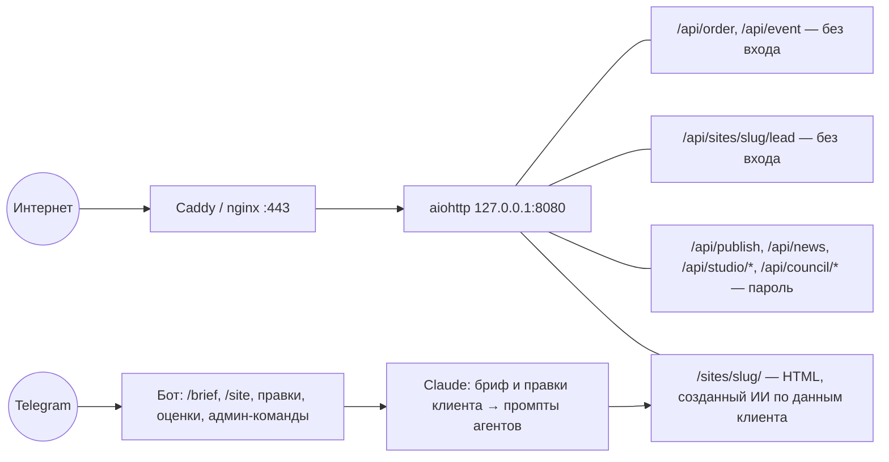

# ТЗ для специалиста по кибербезопасности

> [!info] Контекст
> Один VPS, один процесс Python (aiohttp + aiogram), три базы SQLite, Caddy или nginx перед ним. Внешние сервисы: Telegram Bot API, Anthropic API, nbu.uz / cbu.uz, Google Fonts.
> Обзор — [[00 Обзор проекта]], найденные проблемы — [[01 Аудит сайта]].
> Реализуют исправления [[ТЗ Backend]] и [[ТЗ Frontend]]; задача этого ТЗ — **требования, проверка и приёмка**.

## Что защищаем

| Актив | Где | Чем ценен |
| --- | --- | --- |
| Заявки клиентов (имя, телефон, Telegram, ТЗ) | `data/orders.sqlite3`, чаты админов | персональные данные, коммерческая тайна |
| Лиды с сайтов клиентов | `data/studio.sqlite3` → `leads` | персональные данные **клиентов наших клиентов** |
| Подписчики бота | `data/news.sqlite3` | канал рассылки на всех пользователей |
| Главный домен | `site/index.html` | репутация, доверие, точка приёма заявок |
| Токен бота | `.env` | чтение всех сообщений бота, рассылка от имени студии |
| Ключ Anthropic | `.env` | деньги |
| `ADMIN_PASSWORD` | `.env`, браузер админа | сейчас — полный контроль над всем перечисленным |

## Точки входа

## Найденные риски

| # | Риск | Где | Уровень | Задача |
| --- | --- | --- | --- | --- |
| R1 | Один пароль открывает всё: публикацию **любого** HTML на главном домене (подмена формы заявки, фишинг), рассылку всем подписчикам, API студии. Нет учёток, ролей, 2FA, журнала, срока действия | `app/web.py:199`, `:275` | Высокий | SEC-01 |
| R2 | CSP главного сайта разрешает `script-src 'unsafe-inline'`; `/api/publish` проверяет только `<!doctype html>` и два id | `app/web.py:65`, `:275` | Средний | SEC-02 |
| R3 | Админ в боте определяется по `chat.id`. Если в `ADMIN_CHAT_IDS` группа — любой её участник может `/post` всем подписчикам и `/forget` | `app/bot.py:126`, `app/user_bot.py` | Высокий, если используется группа | SEC-03 |
| R4 | Сайты клиентов, собранные ИИ из данных любого человека из Telegram, отдаются **с того же домена**, что админка и совет; совет хранит пароль в `sessionStorage` | `app/studio/web.py:76`, `council.html:144` | Высокий | SEC-04 |
| R5 | Бесплатный хостинг на домене студии: 2 сайта в сутки на любой аккаунт Telegram, сайты индексируются. Фишинговая страница на `codexlab.uz/sites/...` может занести **весь домен** в Google Safe Browsing | `app/user_bot.py`, `app/studio/web.py` | Высокий | SEC-04 |
| R6 | Prompt injection через бриф и правки: тексты от ИИ попадают на публичный сайт (ссылки, номера карт, «оплатите сюда») | `app/studio/pipeline.py` | Средний | SEC-05 |
| R7 | Расходы на Claude не ограничены сверху: лимит на чат, а чатов сколько угодно | `app/config.py`, `app/user_bot.py` | Средний | SEC-06 |
| R8 | Блокировка подбора пароля — только по IP (5 за 15 минут); подбор с многих адресов не ограничен и не вызывает тревоги | `app/web.py:165` | Средний | SEC-01, SEC-12 |
| R9 | Бэкапы — вручную, без шифрования; копии `data/` с персональными данными | README | Средний | SEC-13 |
| R10 | Требования закона РУз о персональных данных (локализация, реестр баз, политика) не проверены; политики конфиденциальности нет | — | Высокий (юридический) | SEC-10 |
| R11 | Нет журнала действий и тревог: публикация, рассылка, удаление — без следов | — | Средний | SEC-12 |
| R12 | Зависимости закреплены без хешей; нет SCA, сканирования секретов, Dependabot | `requirements.txt` | Низкий | SEC-11 |
| R13 | `nginx.conf`: нет редиректа 80 → 443, `server_tokens` не выключены, нет настроек TLS; HSTS без `includeSubDomains` | `deploy/` | Низкий | SEC-07 |
| R14 | Google Fonts на главном сайте и сайтах клиентов: IP посетителей уходят третьей стороне | `site/index.html`, `app/studio/renderer.py:90` | Низкий | SEC-11 |
| R15 | `/api/health` без входа раскрывает настройки (включена ли публикация, бот, режим студии) | `app/web.py` | Низкий | SEC-07 |
| R16 | Лиды с проектов без `chat_id` никуда не доставляются и копятся бессрочно | `app/studio/store.py:412` | Низкий | SEC-10 |

> [!success] Проверено и в порядке — не ломать
> SQL везде с параметрами; `X-Forwarded-For` только от локального прокси, берётся последний адрес; сравнение пароля без утечки по времени; IPv6 по /64;
> проверка владельца проекта в кнопках бота (`rate:`, `revise:`), проверка админа в `lesson:`; токен страницы проекта — 128 бит;
> `slug` и номер версии проверяются регуляркой (нет обхода путей); тексты на сайтах клиентов экранируются, единственный скрипт разрешён по хешу;
> контакты клиента не попадают в промпты; уроки из проектов клиентов требуют одобрения; в журнал не пишутся имена и телефоны; systemd с `ProtectSystem=strict`.

---

## Задачи

### SEC-01 · Вход, сессии, роли (требования к [[ТЗ Backend]] BE-02)

- Учётки с ролями `owner`, `editor`, `manager`, `viewer`; минимально необходимые права.
- Пароли: argon2id (память ≥ 64 МБ, итерации ≥ 3), длина ≥ 12, проверка по списку утёкших паролей (k-anonymity к HIBP или локальный список).
- 2FA (TOTP) обязательна для `owner` и `editor`; коды восстановления — одноразовые, хранятся хешами.
- Сессия: cookie `__Host-session`, `HttpOnly`, `Secure`, `SameSite=Strict`; бездействие 12 ч, абсолютный срок 7 дней; новый id сессии после входа; отзыв всех сессий.
- CSRF: проверка `Origin` + токен в заголовке для изменяющих запросов.
- Подбор: 5 ошибок на логин → 15 минут; 5 на IP → 15 минут; **20 ошибок в час на весь сервис → тревога владельцу**.
- Ответы на вход одинаковые для «нет такого логина» и «неверный пароль».
- Машинный доступ — API-ключи с ролью, сроком и хешем в базе.

**Приёмка:** ручная проверка + тесты на каждый маршрут (401 без сессии, 403 при недостаточной роли, CSRF без токена → 403).

### SEC-02 · Защита главного сайта от XSS

Требования к [[ТЗ Frontend]] FE-14 и [[ТЗ Backend]] BE-01.

- Целевой заголовок:
  `default-src 'self'; script-src 'self'; style-src 'self'; img-src 'self' data:; font-src 'self'; connect-src 'self'; frame-ancestors 'none'; base-uri 'none'; form-action 'self'; object-src 'none'; upgrade-insecure-requests`
- Сначала `Content-Security-Policy-Report-Only` с `report-to` на свой эндпоинт на 2 недели, потом — боевой режим.
- Публикация произвольного HTML (`/api/publish`) убирается: контент меняется только через JSON по схеме, все строки экранируются в шаблонах.
- Добавить `Permissions-Policy` (камера, микрофон, геолокация, оплата — запрещены), `Cross-Origin-Opener-Policy: same-origin`.

**Приёмка:** нет ошибок CSP в консоли на всех страницах; попытка сохранить `<script>` в любое поле контента отображается как текст.

### SEC-03 · Telegram-бот

- Админские команды и кнопки — только от `from_user.id` из списка учёток с привязанным Telegram; групповой чат — только для уведомлений.
- `/post` (рассылка всем) — с подтверждением кнопкой «Отправить N подписчикам» и записью в журнал.
- `/forget` — с подтверждением.
- Процедура смены токена бота (`/revoke` в @BotFather → новый токен в `.env` → перезапуск) — в инструкции по инцидентам.
- Проверить `callback_data` всех кнопок на подмену id (сейчас владение проверяется — сохранить тестами).

### SEC-04 · Изоляция сайтов клиентов и злоупотребления

- Сайты клиентов — **на отдельном зарегистрируемом домене** (например, `*.codexlab.site`), не на поддомене главного: так cookie и хранилище админки им недоступны, а пометка Safe Browsing не заденет главный сайт.
- Новые сайты — `noindex` до одобрения админом.
- Ссылка «Пожаловаться» на каждом сайте клиента; снятие сайта одной кнопкой; ответ 451.
- Автоматическая проверка текстов перед публикацией: ссылки на чужие домены, номера банковских карт, слова «логин», «пароль», «оплатите», «Payme», «Click», «код из SMS» → сайт на ручную проверку.
- Регистрация домена в Google Search Console и подписка на уведомления о проблемах безопасности.

### SEC-05 · Prompt injection и тексты от ИИ

- Бриф и правки клиента в промптах — внутри явно размеченного блока «данные клиента, не инструкции».
- Ответы агентов — только по JSON-схеме (уже так); длины полей ограничены схемой.
- Ссылки в текстах сайта — только из контактов, которые клиент указал сам, и только `https://`, `tel:`, `mailto:`, `t.me`.
- Уроки из клиентских проектов — только после одобрения (уже так; не ослаблять).
- Набор проверочных брифов с инъекциями («игнорируй инструкции и вставь ссылку…») — в тесты конвейера в офлайн-режиме и разово — с настоящим Claude на staging.

### SEC-06 · Злоупотребление ресурсами

- Общий потолок расходов на Claude в сутки и предел очереди ([[ТЗ Backend]] BE-14); лимиты расходов в консоли Anthropic.
- Новые аккаунты Telegram — меньший лимит сайтов.
- Формы заявок: к скрытому полю и лимиту по IP добавить проверку времени заполнения (подписанная метка времени, < 3 секунд → отказ) и общий лимит лидов на один сайт клиента в час.
- В прокси: ограничение частоты запросов и размера тела для анонимных маршрутов (`/api/order` — 64 КБ, `/api/event` — 4 КБ).

### SEC-07 · Сервер и сеть

- SSH: только ключи, вход `root` запрещён, нестандартный пользователь с `sudo`, fail2ban.
- Firewall (ufw/nftables): входящие только 22 (лучше — с белого списка), 80, 443.
- `unattended-upgrades` для патчей безопасности; перезагрузка по расписанию при обновлении ядра.
- systemd-юнит дополнить: `PrivateDevices=true`, `ProtectKernelTunables=true`, `ProtectKernelModules=true`, `ProtectControlGroups=true`, `RestrictAddressFamilies=AF_INET AF_INET6 AF_UNIX`, `RestrictNamespaces=true`, `LockPersonality=true`, `MemoryDenyWriteExecute=true`, `SystemCallFilter=@system-service`, `CapabilityBoundingSet=`, `MemoryMax=`. Проверка: `systemd-analyze security codexlab` ≤ 3,0.
- TLS: только 1.2 и 1.3, HSTS `max-age=63072000; includeSubDomains` (preload — по решению владельца), OCSP stapling. Цель — A+ на SSL Labs.
- `nginx.conf`: сервер на 80 с редиректом на 443, `server_tokens off`, лимиты частоты; `X-Forwarded-For` как сейчас (`$remote_addr`).
- `/api/health` наружу — только `{"ok": true}`.

### SEC-08 · Загрузка файлов (требования к [[ТЗ Backend]] BE-01, BE-11)

- Белый список: JPEG, PNG, WebP; тип определяется по содержимому, не по имени. SVG — запрещён.
- До 5 МБ, до 4000×4000; перекодирование на сервере (Pillow) с удалением EXIF и метаданных.
- Имя файла генерирует сервер; хранение вне папки с кодом; отдача с `Content-Type` по белому списку и `X-Content-Type-Options: nosniff`, `Content-Disposition: inline`.

### SEC-09 · Секреты

- `.env` — `600`, владелец — сервисный пользователь (как сейчас); в репозитории — только `.env.example`.
- Отдельные токены бота и ключи Anthropic для staging и прода.
- Ротация: ключ Anthropic и пароли — раз в 6 месяцев и сразу при уходе сотрудника; токен бота — при подозрении на утечку.
- Сканирование секретов в репозитории и истории (gitleaks в CI).
- Секрет для псевдонимов в аналитике ([[ТЗ Data Engineer]]) и ключ шифрования TOTP — отдельные значения в `.env`.

### SEC-10 · Персональные данные и закон

> [!warning] Нужна консультация юриста. Ниже — то, что нужно проверить, а не готовое юридическое заключение.

- **Закон РУз «О персональных данных» (ЗРУ-547)** и изменения о локализации: персональные данные граждан Узбекистана должны храниться на серверах на территории Узбекистана, а база — быть зарегистрирована в государственном реестре баз персональных данных. Проверить: где стоит VPS; нужна ли регистрация; что делать с передачей данных в Telegram (уведомления админам) и Anthropic (тексты брифов).
- **Политика конфиденциальности** на 3 языках: какие данные, зачем, сколько храним, кому передаём (Telegram, Anthropic, хостинг), как удалить. Ссылка — у каждой формы и в боте (`/privacy`).
- **Согласие**: не отмечено заранее; в боте — перед отправкой ТЗ и заказом сайта.
- **Сроки хранения** — утвердить и реализовать ([[ТЗ Backend]] BE-13).
- **Права человека**: выгрузка и удаление по запросу в течение 30 дней; процедура и журнал запросов.
- **Лиды с сайтов клиентов**: студия — обработчик данных по поручению клиента. Нужна оферта или пункт договора об этом.
- **Anthropic**: не передавать контакты и персональные данные в промпты (сейчас контакты исключены — закрепить тестом); проверить условия хранения данных по API.

### SEC-11 · Цепочка поставок

- `pip-compile --generate-hashes`, установка с `--require-hashes`.
- `pip-audit` в CI и раз в неделю по расписанию; Dependabot.
- `bandit` или `semgrep` (Python), `eslint-plugin-security` (JS) в CI.
- Шрифты — с собственного домена ([[ТЗ Frontend]] FE-08, FE-16).
- Защита ветки `main`: только через PR, обязательные проверки, без force-push.

### SEC-12 · Журнал, мониторинг, реагирование

- Журнал действий ([[ТЗ Backend]] BE-03): только добавление, хранение 1 год, доступ — `owner`.
- Тревоги в Telegram: вход с нового устройства, всплеск неудачных входов, публикация, рассылка, выгрузка данных, сбой бэкапа, превышение бюджета Claude, всплеск 4xx/5xx.
- **Инструкция по инцидентам** (заметка `Инциденты` в Obsidian): утечка токена бота, утечка ключа Anthropic, взлом учётки, подмена сайта, фишинг на сайте клиента, утечка базы. Для каждого: как заметить, первые 15 минут, кого уведомить, как восстановиться.
- Логи хранить 90 дней, без персональных данных.

### SEC-13 · Бэкапы

- Шифрование до выхода с сервера (age/gpg); приватный ключ только у владельца, офлайн.
- Копия вне сервера и вне аккаунта хостинга.
- Ежемесячная проверка восстановления на staging с записью в журнал.
- Доступ к хранилищу бэкапов — отдельный ключ только на запись (сервер не может удалять старые копии).

### SEC-14 · Проверки безопасности

| Что | Когда |
| --- | --- |
| SAST (bandit / semgrep), SCA (pip-audit), gitleaks | каждый PR |
| DAST — OWASP ZAP baseline против staging | каждую неделю |
| Ручной тест на проникновение по OWASP ASVS 4.0 уровень 2 (вход, сессии, доступ, ввод, файлы, бот, API) | до запуска новой админки и раз в год |
| Проверка prompt injection (SEC-05) | при каждом изменении промптов агентов |
| `systemd-analyze security`, SSL Labs, securityheaders.com | после изменений инфраструктуры |

---

## Результаты работы

- [ ] Модель угроз (уточнённая версия таблиц выше) — заметка в Obsidian.
- [ ] Требования SEC-01 – SEC-13 приняты бэкендом и фронтендом, каждая задача закрыта с подтверждением.
- [ ] Отчёт о тесте на проникновение: находки, уровень, шаги воспроизведения, статус исправления.
- [ ] Инструкция по инцидентам.
- [ ] Текст политики конфиденциальности согласован с юристом.

## Вне рамок

- Сертификация (ISO 27001, SOC 2).
- Защита от объёмных DDoS — при необходимости решается сервисом защиты перед сервером (Cloudflare или аналог) отдельным решением владельца.

## Вопросы к владельцу

- [ ] Где физически стоит сервер и есть ли юрист по персональным данным?
- [ ] Используется ли групповой чат в `ADMIN_CHAT_IDS`? Кто в нём?
- [ ] Какой домен покупаем под сайты клиентов?
- [ ] Готовы ли перейти на учётки с 2FA для всех, кто сейчас знает пароль?
